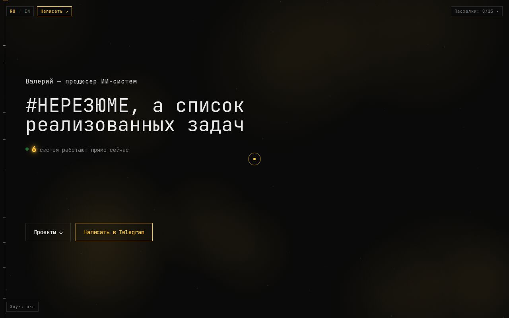

# Сайт-портфолио Валерия (lending2 / vanatat.ru) — игры, боты и автоматизация

## Что это и для кого

Сайт-портфолио `lending2` (репозиторий `Fanatat/lending2`, пакет `lab-terminal-portfolio`, адрес https://vanatat.ru/) — личный
сайт Валерия (основатель студии «Пятница») для работодателей и заказчиков ИИ-автоматизации. Тёмный интерфейс в стиле
лабораторного терминала с интерактивными демонстрациями, анимацией и скрытыми пасхалками. На странице можно открыть
игры студии в VK, посмотреть живые показания домашнего датчика воздуха HP100, познакомиться с восемью «системами»
автоматизации и оставить заявку через форму. Есть русская версия (`/`) и английская (`/en/`).
Другие названия: «Привет от Валеры» (заголовок вкладки), «лендинг 2», lending2, vanatat.



*Локальный запуск сборки, 28 сентября 2026.*

## Ключевые даты и статусы

- Статус: в проде, живой сайт https://vanatat.ru/ отвечает 200 (проверено 2026-10-15, источник: `curl -sI`).
- Последний деплой: 2026-10-14 07:33 GMT, GitHub Pages, коммит `322d0e5` (PR #13, мост HP100); workflow «GitHub Pages» и «Checks» зелёные (источник: `gh run list`).
- Последний коммит в `main`: `322d0e5` от 2026-10-14. Тегов релизов в репозитории нет.
- HTTPS работает: сертификат на `vanatat.ru` и `www.vanatat.ru` одобрен GitHub, действует до 2027-01-02, HTTPS принудительный (источник: `gh api repos/Fanatat/lending2/pages`, 2026-10-15). Замечание от 2026-09-28 о несоответствии сертификата устарело.
- Статусы игр на сайте: 4 опубликованы в VK, 4 на модерации, 1 в разработке (Steam), 3 концепции — счёт основателя от 2026-10-13 (`lib/studio.ts`). Число игроков 4034 — выгрузка кабинета VK от 2026-10-10.
- Яндекс Метрика сайта выключена (`YANDEX_METRIKA_ID = 0`, проверено 2026-10-15).
- Последний бэкап: отдельного бэкапа не подтверждено; код хранится в GitHub `Fanatat/lending2`.
- Последняя выгрузка статистики: у сайта своей статистики нет (Метрика выключена).

## Где живёт и как выкладывается

- Исходники на сервере: `/home/vps_home_1/projects/lending2`. Рабочая копия на сервере может отставать от GitHub: на 2026-10-15 локальная ветка `main` была на 16 коммитов позади `origin/main`, поэтому сверяйтесь с `origin/main`.
- Репозиторий: https://github.com/Fanatat/lending2, ветка `main`; изменения идут через pull request (на 2026-10-14 влито 13 PR).
- Основной домен `vanatat.ru` отдаёт GitHub Pages (в ответе `server: GitHub.com`, в настройках Pages `cname: vanatat.ru`). Старый адрес https://fanatat.github.io/lending2/ перенаправляет (301) на `vanatat.ru`.
- Зеркало на Vercel https://vanatat.vercel.app/ отвечает 200 (2026-10-15); это запасной адрес, и из части российских сетей он недоступен. Собирается ли он из свежего `main`, не подтверждено.
- Деплой — автоматически при пуше в `main`: workflow [pages.yml](.github/workflows/pages.yml) собирает статический экспорт (`PAGES_BASE_PATH`) и публикует `out/`.
- Отдельного сервера под сайт нет, systemd-служб и cron-задач у проекта нет. Секретов в репозитории нет; единственная переменная — `NEXT_PUBLIC_HP100_FEED_URL` (необязательная, пример в `.env.local.example`).

## Разработка и сборка (Next.js 14)

Стек: Next.js 14, React 18, TypeScript, Tailwind CSS, Three.js (интро с планетами), Framer Motion, Lenis (плавный скролл), zustand. Нужны Node.js 22 (версия CI), npm и Git.

```bash
git clone https://github.com/Fanatat/lending2.git
cd lending2
npm ci
# Необязательно: cp .env.local.example .env.local
npm run dev
```

Сайт откроется на http://localhost:3000. Проверки и сборка:

```bash
npm run lint
npm run typecheck
npm run build
npm run start
```

Статический экспорт для GitHub Pages: `PAGES_BASE_PATH=/lending2 npm run build`, результат в `out/` (то же делает workflow). Обычная сборка запускается Node.js-сервером через `npm run start`.

## Проверки в браузере (smoke) и CI

Smoke-проверка `scripts/smoke.mjs` читает `sitemap.xml`, открывает каждую страницу и скрытую `/projects/bridge/` в headless Chromium и падает при любой ошибке консоли (так ловятся hydration-расхождения). Запуск: `npx playwright install chromium`, затем при работающем сайте `SMOKE_BASE_URL=http://localhost:3000 npm run smoke`. Запрос HP100 к `api.vanatat.ru` скрипт подменяет образцом ответа: с localhost эндпоинт не отвечает из-за CORS. В GitHub Actions workflow [checks.yml](.github/workflows/checks.yml) на каждый pull request и каждый пуш в `main` собирает статический экспорт, поднимает его через `python3 -m http.server 3000 --directory out` и гоняет smoke. Playwright закреплён в `package.json` (1.62.0).

## Данные на странице: живой виджет HP100

HP100 (виджет воздуха, `components/sections/hp100/HP100Widget.tsx`, источник `lib/hp100-live.ts`) показывает CO₂, температуру, влажность и пыль домашнего датчика. Цепочка: браузер → `https://api.vanatat.ru/site/air` → мост на домашнем сервере → сервер платы (`~/projects/utility/health_air/airmonitor_vps.py`, служба `airmonitor.service`, на 2026-10-15 active). Браузер опрашивает эндпоинт раз в минуту (ответ кешируется на 30 секунд) и получает последнее измерение с его временем и историю за 24 часа шагом 15 минут. CORS разрешён только для своих адресов (vanatat.ru, www, fanatat.github.io, vanatat.vercel.app); код 502 означает, что сервер платы выключен. Показание старше 20 минут помечается как устаревшее и выводится со временем замера, а не как «живое». Если эндпоинт недоступен совсем, включается демонстрационный источник `lib/mock/hp100.ts` с пометкой «нет связи». Сервер платы раньше выключали на ночь (ориентировочно 21:00–05:30 МСК); при проверке 2026-10-15 01:01 МСК показание было свежее (`updated` 22:01Z), поэтому актуальный график работы не подтверждён.

Остальные данные: портфель в блоке All in — сгенерированные демонстрационные значения, не реальный счёт; игры и системы — демонстрации и ссылки на отдельные сборки.

## Форма заявки

В блоке контактов (`components/sections/closing/LeadForm.tsx`, RU и EN, добавлена 2026-10-14) посетитель оставляет имя (необязательно), контакт (почта, @ник Telegram или телефон) и описание задачи (10–3000 символов). Форма отправляет JSON на `https://api.vanatat.ru/site/lead` (n8n за прокси сервера); адрес задаётся `NEXT_PUBLIC_LEAD_URL` или значением по умолчанию в `lib/site.ts`. Валидация дублируется на сервере. Подпись на форме честно сообщает, что текст раскладывает на пункты Google Gemini. Кнопки связи: Telegram `t.me/fanatat` и MAX (`MAX_URL` в `lib/site.ts`); телефона и почты на сайте нет. GET-запрос к эндпоинту формы возвращает 403 — это нормально, принимается только POST со своего сайта.

## Площадки и статусы игр студии на сайте

Сайт показывает студию «Пятница» (slug `friday-studio`). На 2026-10-13 (счёт основателя, резюме v3): 9 игр сделано — 4 опубликованы в VK, 4 на модерации, 1 в разработке (готовится к Steam) — плюс 3 концепции. Карточки («картриджи») есть только у опубликованных игр: Словоход (slovokhod / game1, https://vk.com/app54674073), «Кот и японские кроссворды» (nonograms / catnonogram, app54676906), «Сортировка: Цвет и Форма» (color-sort, app54683949), «Две крепости» (lane-battler, app54759696). Остальные игры считаются числами в блоке «Конвейер игр» без названий. Данные: `components/sections/friday/data.ts`, `lib/studio.ts`. Цифры и источник счётчика игроков 4034 (VK, «Участники (лайфтайм)», выгрузка 2026-10-10) описаны в комментарии `lib/studio.ts`; Яндекс Игры число игроков не дают, поэтому в сумму не входят. Этот README статусы модерации конкретных игр не отслеживает (см. проекты `game_studio` и `studio-promo`); здесь только то, что показано на сайте.

## Структура репозитория

- [app/](app/) — страницы Next.js: `page.tsx` (главная RU), `en/page.tsx` (английская версия), `projects/[slug]` (страницы систем), `og.png/route.tsx`, `sitemap.ts`, `robots.ts`, `layout.tsx`.
- [components/](components/) — интерфейс: `hero`, `intro` (3D-парад планет, показывается при первом заходе, «Смотреть интро снова» в подвале), `sections` (Оператор, Пятница, Студия, HP100, Автопилот, Мост, All in, Завод, Штат, Периметр, Контакты), `easter-eggs`, `effects` (в т.ч. `YandexMetrika.tsx`).
- [lib/](lib/) — данные и логика: `projects.ts`, `studio.ts`, `operator.ts`, `systemCopy.ts`, `systemStatus.ts`, `site.ts` (адреса и ссылки), `hp100-live.ts`, `mock/`.
- [public/](public/) — звуки (`sounds`, лицензии в `sounds/CREDITS.md`) и текстуры планет (`textures`).
- [scripts/smoke.mjs](scripts/smoke.mjs) — браузерная проверка страниц; [docs/](docs/) — скриншот.
- Локальная папка `reference/` (видео-референсы дизайна) в git не входит (`.gitignore`).

## Восемь систем на сайте

Главная страница — дашборд из восьми систем: Студия «Пятница» (игры и промо), HP100 (датчик воздуха), Автопилот каналов (`channel-autopilot`), Мост (`bridge`, скрытая пасхалка, вне sitemap и цепочки «дальше/назад»), All in (`all-in`), Контент-завод (`content-factory`), Штат агентов (`staff`), Периметр (`perimeter`). У каждой есть страница `/projects/<slug>/`. Даты запуска систем, показанные в строке статуса, взяты из первых коммитов и файлов: HP100 — 2026-06-07, Автопилот — 2025-04-01, Мост — 2026-08-24, All in — 2026-08-25, Штат — 2026-05-18, Периметр — 2026-08-28; у «Пятницы» и Завода даты не подтверждены (в `lib/systemStatus.ts` стоит `null` и пометка TODO).

## Яндекс Метрика

Счётчик сайта задаётся в `YANDEX_METRIKA_ID` ([lib/site.ts](lib/site.ts)); `0` — Метрика выключена, и по состоянию на 2026-10-15 она выключена. Подключение — [components/effects/YandexMetrika.tsx](components/effects/YandexMetrika.tsx). Счётчик должен быть отдельным от счётчиков игр, чтобы данные не смешивались.

## Принятые решения

- Решено 2026-10-12 (правки основателя): в шапке показывать голые цифры без длинных пояснений; адреса, порты и версии серверов на сайте не публиковать — это «обычная гигиена».
- Сделано 2026-09-28 (коммит `31451de`, исправления по аудиту): честные подписи — Автопилот (сводка вручную), All in (сгенерированные цифры), Штаб (симуляция), Контент-завод (технический прогон с заглушками); интро по решению основателя не менялось.
- Сделано 2026-10-14 (коммит `398c715`): HP100 читает показания напрямую с `api.vanatat.ru/site/air` вместо промежуточной GitHub-ленты (`raw.githubusercontent.com`); так на графике настоящая история за сутки, а `updated` — время самого замера. Ссылка «Лента показаний на GitHub» с сайта убрана.
- Сделано 2026-09-24 (коммит `7857521`): сайт собирается в два варианта из одного кода (Node.js для Vercel и статический экспорт для GitHub Pages), потому что vanatat.vercel.app не открывался из части российских сетей (check-host: таймаут с двух московских узлов из трёх), а github.io отвечал со всех.

## Известные проблемы

- Рабочая копия на сервере отстаёт от `origin/main`, в ней висят незакоммиченные правки `lib/hp100-live.ts` (комментарий с путями `~/projects/utility/…`) и файл `site_audit.md` (теперь в `reports/lending2/site_audit.md`); в `origin/main` комментарий ещё со старыми путями.
- Если график HP100 пуст, проверьте `api.vanatat.ru/site/air` и службу `airmonitor.service` на сервере; код 502 — сервер платы выключен.
- Метрика отключена; хит-статистики по посетителям нет.

## Частые вопросы

**Где лежит сайт и на чём работает?** Исходники — `/home/vps_home_1/projects/lending2` и репозиторий `Fanatat/lending2`; живой сайт — https://vanatat.ru/ на GitHub Pages (резерв — vanatat.vercel.app).

**Как выложить правку?** Сделать ветку, открыть pull request в `main`; после слияния workflow «GitHub Pages» сам публикует сайт. Слияние делает основатель.

**Когда был последний деплой?** 2026-10-14 07:33 GMT, коммит `322d0e5`, мост HP100.

**Есть ли у сайта HTTPS?** Да: сертификат на `vanatat.ru` и `www.vanatat.ru` одобрен, действует до 2027-01-02, замечание от 2026-09-28 устарело.

**Откуда берутся данные HP100 и почему иногда они старые?** С `api.vanatat.ru/site/air`; показание старше 20 минут помечается как устаревшее и подписывается временем замера, выдуманных цифр нет.

**Сколько игр и какие на модерации?** По сайту (счёт основателя 2026-10-13): 9 игр — 4 в VK, 4 на модерации, 1 в разработке, плюс 3 концепции. Названия игр на модерации на сайте не раскрыты; статус каждой смотрите в `game_studio`.

**Куда уходят заявки с формы?** POST на `https://api.vanatat.ru/site/lead` (n8n), их читает основатель; обработку текста делает Google Gemini.

**Подключена ли аналитика?** Нет, `YANDEX_METRIKA_ID = 0`.

**Чем `lending2` отличается от `lending3`?** `lending3` — черновик ТЗ интро (в репозиторий не входит, указан в `.gitignore`); интро из него реализовано в `lending2`.

Актуализировано: 2026-10-15, сверено с `322d0e5`.
